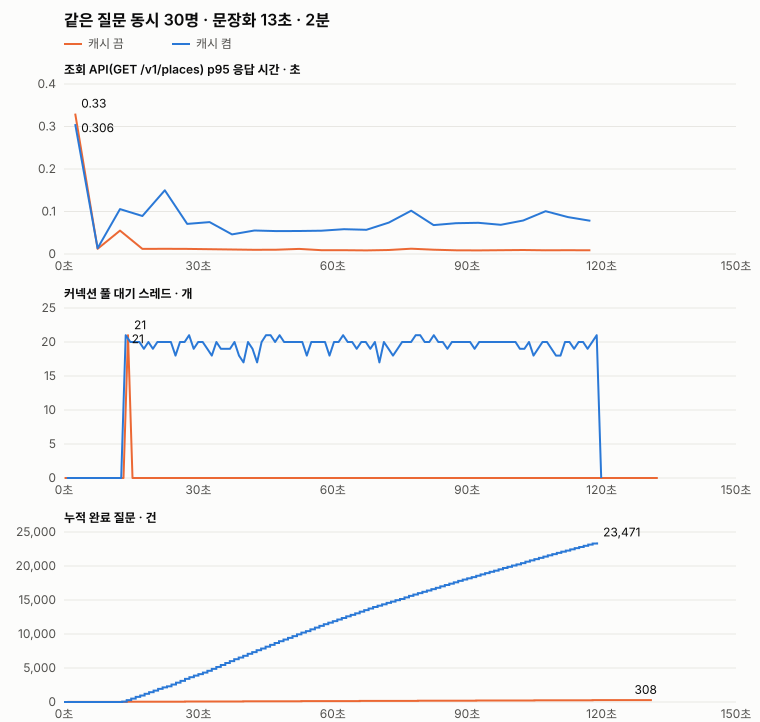

# 같은 질문 문장화 결과 캐시 — 켜기 전 · 후

S15P31C108-261. 앞 측정은 [question-load-test.md](question-load-test.md)(문장화를 트랜잭션 밖으로, S15P31C108-254 · 260).

## 한 줄 요약
같은 질문이 동시에 30명씩 2분 동안 몰렸을 때 **engine(LLM) 호출은 300번 → 1번**, 질문 응답 p50 은 **13.0초 → 0.13초**가 됐다.
이제 병목은 LLM 이 아니라 DB(판정 · 저장)다.

## 무엇을 했나
- `PhrasingCache`(backend 메모리): 문장화 요청에서 실행마다 새로 만드는 `run_id` · `question_id` 를 뺀 JSON 의 SHA-256 을 키로
  engine 결과를 담는다. 근거 · 기사 · 카드 승인본 · 기간 중 하나라도 바뀌면 다른 키다.
- 담는 것은 다시 써도 되는 결과(`done` + 보증 · 반박 모양)뿐. 실패 · 시간 초과 · 건너뜀은 담지 않아 다음 질문이 다시 부른다.
- 같은 키가 동시에 오면 처음 요청만 engine 을 부르고 나머지는 그 결과를 같이 받는다(single-flight). 그래서 몰린 첫 순간에도 engine 은 한 번.
- 크기 500 · 유효기간 24시간(`ENGINE_CACHE_SIZE` · `ENGINE_CACHE_TTL`, 크기 0 = 끔). 가장 오래 안 쓴 것부터 뺀다.
- 실행 기록은 그대로 실행마다 한 행씩 쓴다. 캐시로 받은 실행도 `argument_phrasing` 에 같은 상태 · 인용 · 모델이 남고
  `duration_ms` 는 실제 기다린 시간(거의 0)이다. 로그 `argument_phrasing … engine|cache|shared` 로 어디서 왔는지 본다.
- C2 응답 · DB 스키마 · 계약은 바뀌지 않는다.

## 조건
앞 측정과 같다(동시 30명이 쉬지 않고 같은 질문 · 가짜 engine 13초 · 조회 API 초당 5건 · 2분 · 시험마다 새 DB).
같은 jar 로 `ENGINE_CACHE_SIZE=0`(끔)과 기본값(켬)을 비교했다.

## 결과
| 항목 | 캐시 끔 | 캐시 켬 |
| --- | ---: | ---: |
| 질문 성공 | 308 / 308 | 23,471 / 23,471 |
| 질문 처리량(건/분) | 141.1 | 11,834.1 |
| 질문 p50 · p95(초) | 13.0 · 14.4 | 0.13 · 0.18 |
| engine 호출 | 300 | **1** |
| 조회 성공 | 601 / 601 | 601 / 601 |
| 조회 p50 · p95(ms) | 8 · 12 | 53 · 87 |
| 풀 대기 스레드 | 0 (시작 순간 21) | 내내 17~21 |

- 캐시 켬: backend 로그로 보면 engine 1건 + 진행 중이던 결과를 같이 받은 29건 + 캐시 23,441건. 첫 13초는 30명 모두
  한 번의 engine 호출을 기다렸고(그래프에서 누적이 0), 그 뒤로는 질문 1건이 0.1초대에 끝났다.
- 질문이 쉬지 않고 초당 약 200건 들어오자 풀 10개가 내내 차고 대기 스레드가 20개 안팎 쌓였다. 조회 API 도 8ms → 53ms 로 느려졌지만
  실패는 없었다. LLM 대기가 사라지면서 DB(판정 조회 · 실행 기록 저장)가 다음 병목으로 드러난 것이다.

## 읽을 때 주의
- **가장 좋은 경우다.** 모든 사용자가 같은 질문을 했다. 실제 효과는 같은 (지역 · 카드 · 기간) 질문이 얼마나 반복되는지에 달려 있다.
  데모 · 발표처럼 같은 화면을 여러 사람이 누르는 경우, 새로고침 · 재시도에 가장 크다.
- 사용자에게 think time 이 없는 닫힌 부하라 처리량 11,834건/분은 "LLM 대기가 사라지면 서버가 이만큼 받는다"는 뜻이지
  실제 트래픽 예측이 아니다.
- 서버 한 대 메모리 캐시다. 재시작하면 비고, 서버가 여러 대면 서버마다 따로 담는다. engine 프롬프트 · 모델을 바꿔도 유효기간까지는
  앞 결과를 쓰므로, 바로 반영하려면 backend 를 다시 띄운다.
- 비용: 같은 질문 300건이 LLM 호출 1번이 됐다. LLM 은 호출 수만큼 토큰 비용이 드니 비용도 그만큼 준다.
