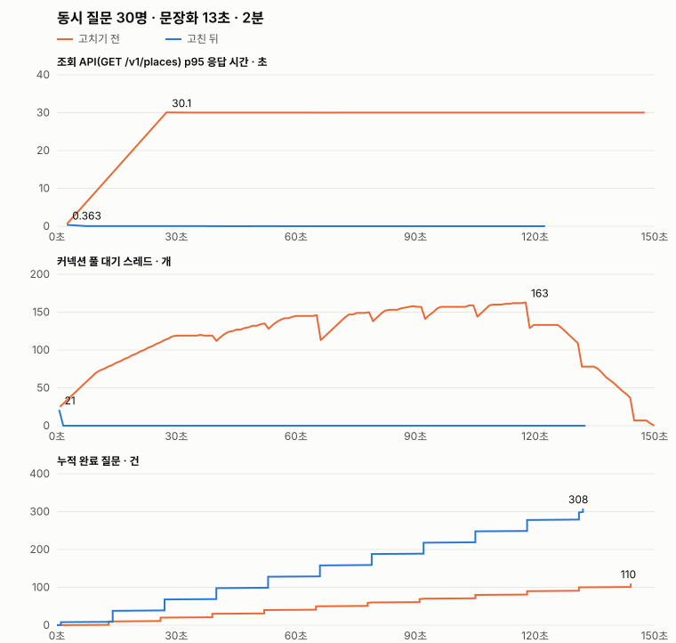

# 질문 실행 부하 시험 — 문장화를 트랜잭션 밖으로 뺀 전 · 후

S15P31C108-260. 고친 작업은 S15P31C108-254(MR !163, 커밋 `bf718ab`). 장치와 다시 돌리는 법은
[backend/loadtest/README.md](../../backend/loadtest/README.md).

## 한 줄 요약
LLM 문장화(평균 13초)를 DB 트랜잭션 밖으로 빼자, 같은 조건에서 **질문 처리량은 3.2배(44 → 140건/분)** 가 됐고
질문이 몰리는 동안 **다른 API 실패율은 65% → 0%, p95 응답 시간은 29.7초 → 14ms** 가 됐다.

## 원인
`QuestionService.create()` 전체가 `@Transactional` 이었고, 그 안에서 engine 문장화(외부 LLM)를 불렀다.
질문 1건이 LLM 을 기다리는 13초 동안 DB 연결 1개를 트랜잭션을 연 채 잡고 있었다.
Hikari 기본 풀은 10개라 동시 질문 10건이면 연결이 바닥나고, 나머지 요청은 **질문과 상관없는 조회 API 까지**
연결을 기다리다 30초(`connectionTimeout`) 뒤 500 으로 끝난다.

## 조건
| 항목 | 값 |
| --- | --- |
| 부하 | k6 `constant-vus` 30명이 쉬지 않고 `POST /v1/questions`(C1 · 광주 북구 · 2023–2026) + `constant-arrival-rate` 초당 5건 `GET /v1/places` |
| 시간 | 2분(진행 중 요청은 끝날 때까지 기다림) |
| engine | 가짜 engine, 모든 문장화에 13초 뒤 done (실측 평균 13초) |
| backend | 같은 머신에서 jar 실행. 고치기 전 = `544bc68`, 고친 뒤 = `bf718ab`. 두 커밋의 backend 차이는 `QuestionService` 하나(이 수정)뿐이고 설정도 같음 |
| DB | 시험마다 새 PostGIS 컨테이너 + 카드 시드. Hikari 기본값(최대 10, 대기 30초) |
| 측정 | k6 요청별 기록 · Hikari 1초 통계(`active` · `waiting`) · `pg_stat_activity` 1초 기록 |
| 머신 | Windows 11 · 22코어 · Java 21.0.11 · Docker Desktop (k6 도 같은 머신) |

## 결과
| 항목 | 고치기 전 | 고친 뒤 |
| --- | ---: | ---: |
| 질문 성공 | 110 / 112 | 308 / 308 |
| 질문 처리량(건/분) | 44.3 | 140.0 |
| 질문 p50 · p95(초) | 39.2 · 40.3 | 13.0 · 14.3 |
| 조회 성공 | 179 / 506 | 601 / 601 |
| 조회 p50 · p95(ms) | 27544 · 29732 | 9 · 14 |
| 조회 최대(ms) | 30061 | 513 |
| 풀 사용 최대(10개 중) | 10 | 10 (시작 1초) |
| 풀 대기 스레드 최대 | 163 | 21 (시작 1초) |
| 트랜잭션 안에서 놀던 연결 최대 | 10 | 1 |
| engine 호출 | 120 | 300 |

- **고치기 전**: 시험 시작 몇 초 만에 풀 10개가 모두 찼다. 기록한 109초 중 107초 동안 연결 10개가 전부
  `idle in transaction`(트랜잭션을 연 채 LLM 응답을 기다림)이었다. 연결을 기다리는 스레드가 최대 163개까지 쌓였고,
  backend 로그에 `Connection is not available, request timed out after 30005ms` 가 990줄 남았다.
  조회 API 는 p95 가 대기 한도인 30초에 붙었고 3건 중 2건이 실패했다.
- **고친 뒤**: 연결은 판정 · 저장의 짧은 트랜잭션에서만 잠깐 쓰인다. 시험 첫 1초에 30건이 한꺼번에 판정에 들어간
  순간 한 번 풀이 찼다(대기 21) — 그 뒤 2분 동안 대기는 계속 0, 사용 중 연결은 1초 표본에서 2개 이하였다.
  질문이 30건 동시에 LLM 을 기다리는 동안에도 조회 API 는 평소처럼 10ms 안팎이었다.

## 숫자가 맞는지
- 고치기 전 처리량의 이론 상한은 풀 크기 ÷ 문장화 시간 = 10 ÷ 13초 ≈ **46건/분**, 측정 44.3. 풀이 병목이었다.
- 고친 뒤 상한은 동시 사용자 ÷ 문장화 시간 = 30 ÷ 13초 ≈ **138건/분**, 측정 140.0(마지막 진행 중 요청 포함). 이제 병목은
  DB 가 아니라 LLM 지연 자체다.
- 고치기 전 질문 p50 39초 = 연결 대기 약 26초 + 문장화 13초.

## 한계
- 가짜 engine 은 지연만 흉내 낸다. 실제 LLM 의 지연 편차 · 동시 처리 한도 · 토큰 비용은 반영하지 않는다.
  고친 뒤에는 동시에 30건이 engine 으로 가므로, 실제로는 engine(·모델 API) 쪽 동시 처리 한도가 다음 병목이 된다.
- k6 · backend · DB 가 한 머신에서 돌았다. 절대값보다 같은 조건의 전 · 후 비교로 읽는다.
- 운영 질문 한도(IP 당 분당 10건)는 시험에서 껐다.

## 다음
- 같은 질문의 문장화 결과 캐시(S15P31C108-261): 같은 입력이면 engine 을 다시 부르지 않는다.
